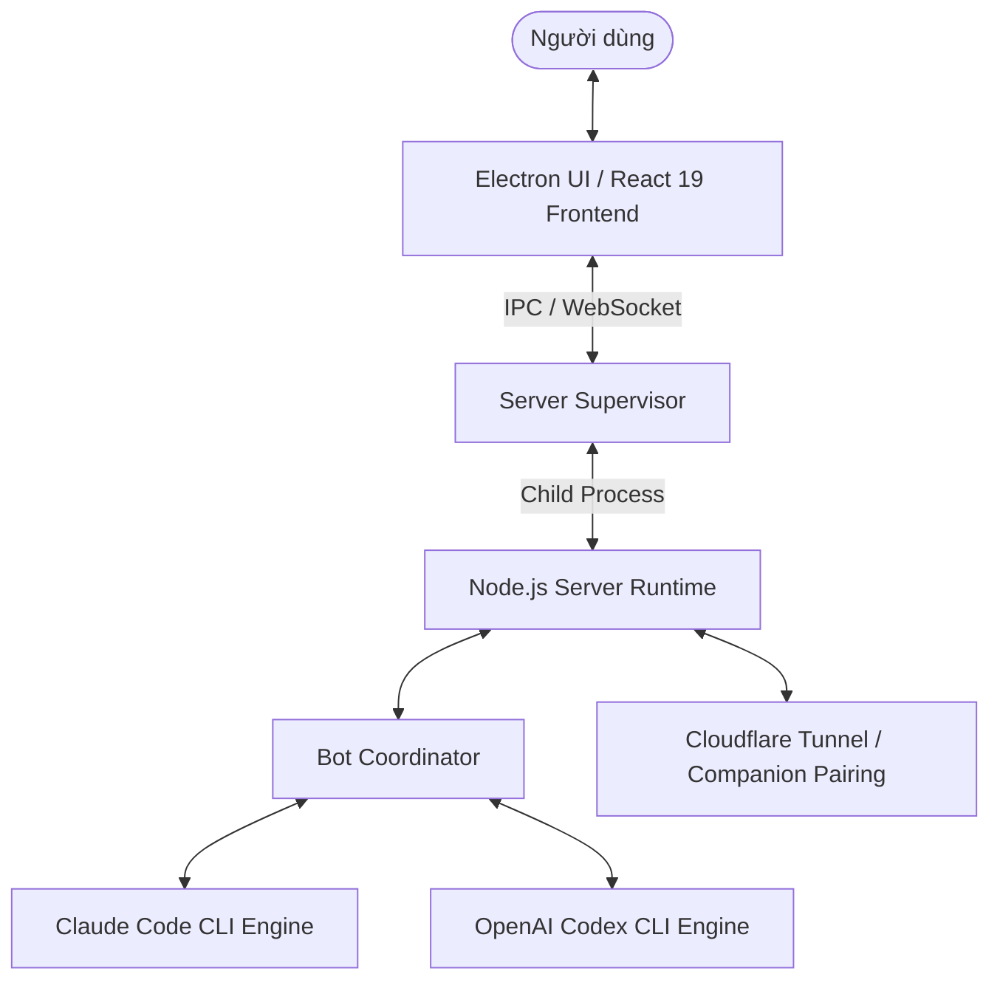

# Kiến Trúc Hệ Thống OpenMausBot

Tài liệu này mô tả chi tiết kiến trúc kỹ thuật, quy ước phát triển và cấu trúc thư mục của dự án **OpenMausBot** trong hệ sinh thái **H-KTO**.

---

## 1. Tổng Quan Dự Án

**OpenMausBot** là ứng dụng chat đa tác tử AI (AI Agents Team) chạy theo mô hình **Local-first**, hỗ trợ điều phối nhiều engine AI (Claude Code, OpenAI Codex, Muse,...) để cộng tác, giải quyết các tác vụ lập trình, nghiên cứu, duyệt web và tự động hóa.

- **Mô hình triển khai:** Electron Desktop App (Windows/macOS/Linux) tích hợp sẵn Server runtime ngầm và giao diện web hiện đại.
- **Kho mã nguồn:** Fork tại [haisodep6868-alt/OpenMausBot](https://github.com/haisodep6868-alt/OpenMausBot.git), đồng bộ với upstream [milind-soni/OpenMausBot](https://github.com/milind-soni/OpenMausBot.git).
- **Nhánh làm việc chính:** `dev` (giữ `main` sạch để cập nhật upstream).

---

## 2. Công Nghệ & Môi Trường Nền (Tech Stack)

| Thành phần | Phiên bản / Công nghệ | Vai trò |
| :--- | :--- | :--- |
| **Node.js** | `>= 24.0.0` (Khuyến nghị 24.10+) | Runtime chính của server & scripts (`--experimental-strip-types`) |
| **Package Manager** | `pnpm` (v10.33.0+) | Quản lý gói dependencies trong monorepo / workspace |
| **Desktop Host** | `Electron 43.x` | Đóng gói ứng dụng desktop, quản lý tiến trình, IPC, native UI |
| **Frontend UI** | `React 19` + `TypeScript 6/7` | Giao diện tương tác người dùng |
| **Styling** | `Tailwind CSS 4` + `@tailwindcss/vite` | Hệ thống thiết kế giao diện |
| **Bundler & Build**| `Vite 7.x` + `esbuild` | Đóng gói tài nguyên giao diện |
| **Bot Engines** | `@anthropic-ai/claude-code`, `@openai/codex` | Các CLI engine thực thi lệnh của tác tử |
| **Đường hầm / Kết nối** | `cloudflared` (Cloudflare Tunnels) | Hỗ trợ chia sẻ, remote pairing và kết nối companion |

---

## 3. Cấu Trúc Thư Mục Chi Tiết

```text
D:\OpenMausBot\
├── .git/                      # Cấu hình Git (origin: haisodep6868-alt, upstream: milind-soni)
├── electron/                  # Tầng Desktop Electron
│   ├── main.mjs               # Entry point chính của Electron (khởi tạo app, cửa sổ, tray)
│   ├── server-supervisor.mjs  # Giám sát và quản lý vòng đời tiến trình Server ngầm
│   ├── cua.mjs                # Computer Use Agent (CUA) module
│   ├── speech.mjs             # Voice/Speech assistant integration
│   └── updater.mjs            # Quản lý cập nhật desktop app
├── src/                       # Frontend UI (React 19 + Vite)
│   ├── components/            # Các UI component (Chat, Settings, Bot dialogs, Cards)
│   ├── hooks/                 # Custom React hooks
│   ├── lib/                   # Utility functions & helpers
│   ├── state/                 # State management (Zustand/React Context)
│   └── App.tsx                # Giao diện chính của ứng dụng
├── server/                    # Backend Server Runtime (Node.js)
│   ├── index.ts               # Khởi tạo HTTP / WebSocket server & route dispatching
│   ├── dev-server.ts          # Entry point cho chế độ phát triển (pnpm dev:server)
│   ├── coordinator.ts         # Điều phối đa bot, phân công nhiệm vụ
│   ├── drivers/               # Trình điều khiển kết nối bot engine (Claude, Codex,...)
│   ├── host/                  # Xử lý các phiên làm việc (sessions, transcripts, ask-cards)
│   └── routes/                # Các endpoint API nội bộ
├── packages/                  # Workspace packages
│   └── phone-protocol/        # Giao thức truyền tin điện thoại / Companion app
├── skills/                    # Bộ kỹ năng mở rộng của Bot
│   ├── create-verification-skill/
│   ├── data-dashboards/
│   ├── phone-connection/
│   └── social-posts/
├── scripts/                   # Scripts kiểm tra, chuẩn bị binary và đóng gói
│   ├── prepare-cloudflared.mjs # Tải và chuẩn bị binary cloudflared phù hợp với OS
│   ├── check-electron.mjs     # Kiểm tra tính toàn vẹn cú pháp các module Electron
│   └── install-git-hooks.mjs  # Thiết lập pre-push Git hook
└── docs/                      # Tài liệu dự án & Hướng dẫn kỹ thuật
    ├── ARCHITECTURE.md        # Kiến trúc tổng quan (file này)
    ├── CURRENT_SPEC.md        # Đặc tả kỹ thuật và trạng thái hiện tại
    ├── TASK_BOARD.md          # Bảng theo dõi tiến độ công việc
    └── verification/          # Hướng dẫn kiểm thử và xác minh tính năng
```

---

## 4. Cơ Chế Hoạt Động (Runtime & Data Flow)



1. Khi người dùng mở app (`pnpm dev:desktop`), Electron `main.mjs` khởi động.
2. `server-supervisor.mjs` kích hoạt tiến trình con Node.js chạy Server (`server/index.ts`).
3. Giao diện React hiển thị và kết nối qua WebSocket / local HTTP port để nhận stream hội thoại thời gian thực.
4. Tác tử AI gọi các CLI engine (`claude`, `codex`) cục bộ để thực thi các tác vụ shell, đọc code, tạo file.

---

## 5. Các Lệnh Thao Tác Thường Dùng (Commands)

| Lệnh | Ý nghĩa |
| :--- | :--- |
| `pnpm dev:desktop` | Khởi chạy ứng dụng Desktop đầy đủ ở chế độ phát triển |
| `pnpm dev` | Chạy dev server Vite cho giao diện web UI |
| `pnpm dev:server` | Chạy server backend độc lập |
| `pnpm build` | Biên dịch toàn bộ TypeScript và đóng gói Vite web assets |
| `pnpm check:electron` | Kiểm tra cú pháp và tính tương thích của mã nguồn Electron |
| `pnpm package:win` | Đóng gói ứng dụng thành bộ cài đặt Windows (.exe) |

---

## 6. Lịch Sử Lỗi & Phòng Tránh (Bug History & Invariants)

1. **Phiên bản Node.js:** Dự án yêu cầu Node.js `>= 24` vì sử dụng cờ `--experimental-strip-types` và các API buffer/crypto mới. Không chạy với Node.js 22 trở xuống.
2. **Cài đặt Electron binary trên Windows:** Khi cài mới hoặc xoá `node_modules`, cần đảm bảo binary Electron được tải về đầy đủ (`node node_modules/electron/install.js`).
3. **Cài đặt gói pnpm qua Sandbox:** Trên môi trường Windows sandbox, các lệnh thêm/thay đổi gói (`pnpm install`, `pnpm add`) bắt buộc chạy unsandboxed để tránh lỗi phân quyền `EPERM`.
4. **Git Safe Directory:** Khi làm việc trên Windows với quyền Admin/User khác nhau, luôn đảm bảo thư mục `D:/OpenMausBot` đã được thêm vào `git config --global --add safe.directory`.
